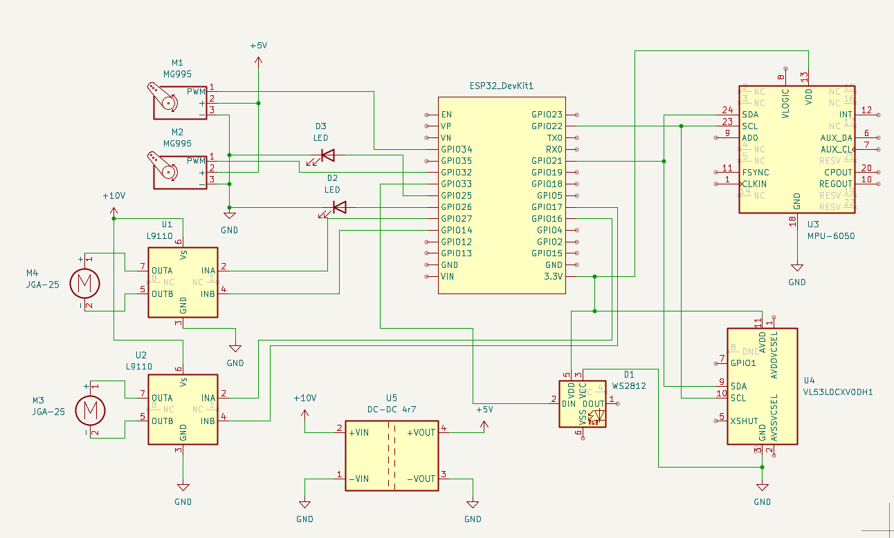
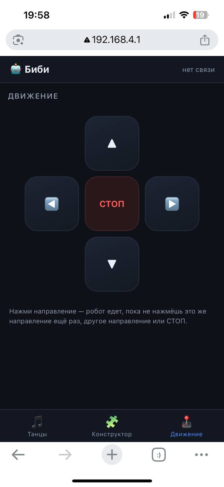

## Биби — танцующий робот на ESP32

**Биби** — настольный робот-компаньон с лицом на светодиодной RGB-матрице 8×8, подвижными руками и веб-интерфейсом для управления с телефона. Танцует тренды из Reels, позволяет собирать собственные хореографии из блоков (как в Scratch), видит препятствия через лазерный дальномер и ездит по комнате влево-вправо-вперёд-назад. Управление — по Wi-Fi с любого телефона, приложение открывается в браузере.

---

##  Фото и видео

Лицо — светодиодной RGB-матрице 8×8


---

## 🔌 Принципиальная схема подключения




## Список деталей со стоимостью

Цены — ориентир по России на октябрь 2026 года

 № | Компонент | Кол-во | Цена (₽/шт) | Итого (₽) | Примечание |
|---|---|---|---|---|---|
| 1 | Микроконтроллер ESP32 | 1 | 450 | 450 | |
| 2 | Cветодиодная RGB-матрица 8×8 (64 светодиода) | 1 | 630 | 630 | **Лицо Биби** |
| 3 | Провода для пайки (Dupont, припой, термоусадка) | набор | 50 | 50 | |
| 4 | DC-моторы JGA-25 | 2 | 100 | 200 | |
| 5 | Сервоприводы MG995 (9 г, 180°) | 2 | 386| 772 | Для подъёма рук; для поворота нужно ещё 2 шт |
| 6 | Аккумуляторы 18650 (3.7 В, защищённые) | 3 | 84 | 252 | |
| 7 | Держатель 18650 | 3 | 168 | 552 | |
| 8 | Драйвер моторов L9910  | 2 | 173 | 346 |  |
| 10 | НПУ 6050 акселерометр + гироскоп | 1 | 250 | 250 | |
| 11 | Лазерный дальномер VL53LOCX | 1 | 250 | 250 |
| 12 | Пластик для 3D-печати PLA, 1 кг | 1 | 1157 | 1157 | |
| | | | **ИТОГО:** | 4 909 | |

## Краткая инструкция
1. Скачайте проект
``` git clone https://github.com/<username>/bibi-robot.git```

```cd bibi-robot```
3. Запустите сервер
4. Для подключения к роботу через смартфон, подключитесь к WIFI с названием BIBI_APP, пароль: 12345678
5. Перейти по IP-адресу: 192.168.4.1
6. В приложении 3 вкладки:
6.1. Танцы

Здесь бибилиотека готовых трендовых танцев, которые можно сразу запустить
6.2 Конструктор
 
Данная вкладка дает возможность самостоятельно запрограммировать свой танец с помощью технологии блочного программирования
6.3. Движение

С помощью этой вкладки можно перемещать робота

